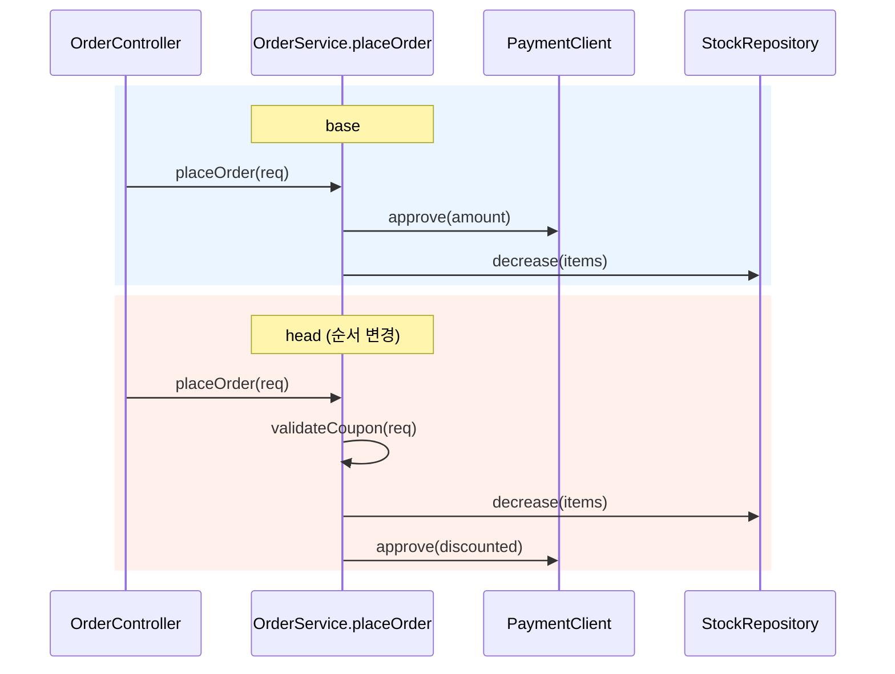
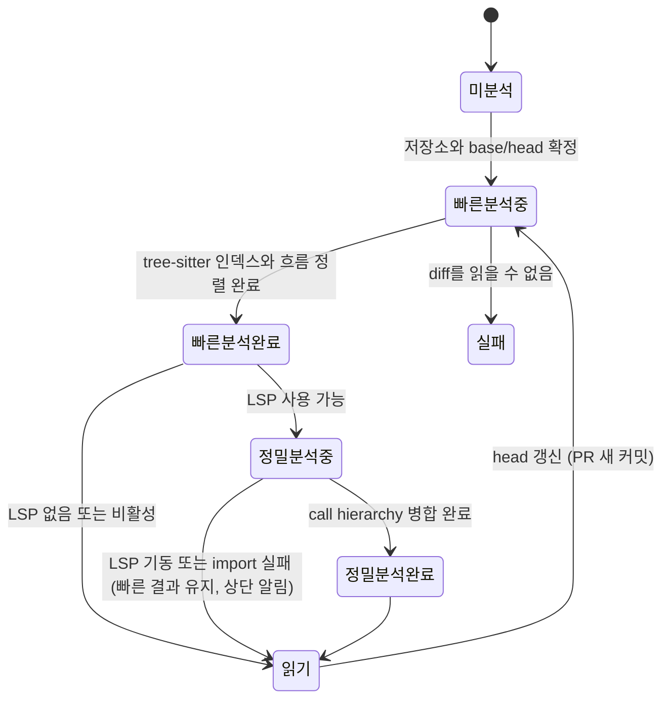
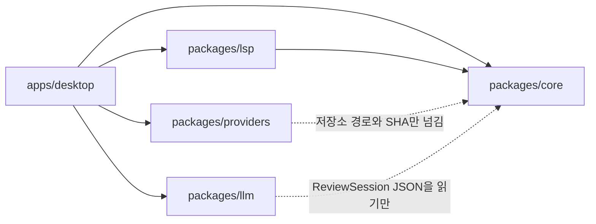
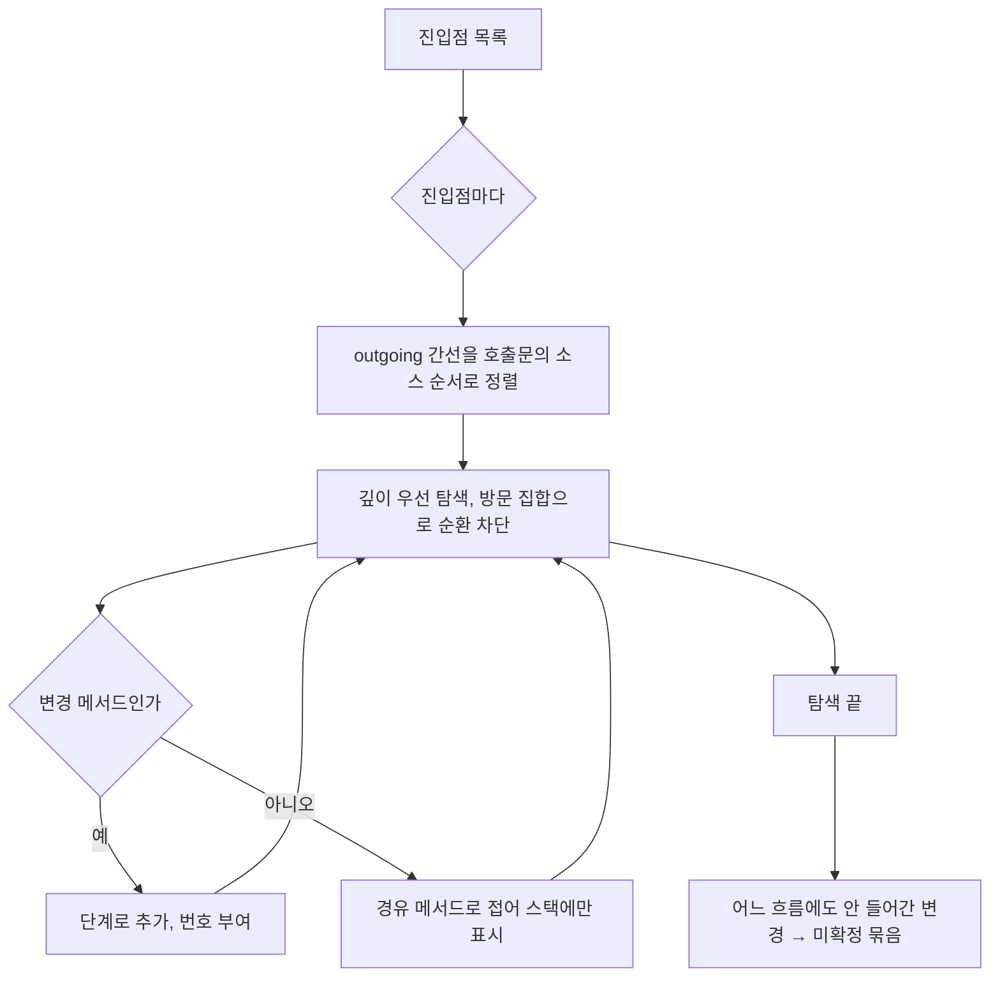

# 흐름 중심 코드 리뷰 앱 설계

- 앱 이름: Callpath (2026-10-28 결정, [D8](decisions.md#d8-앱-이름-callpath))

- 상태: 승인 (v0.1, 2026-10-28 승인). v0.1.1에서 2단계 구현 중 확정한 규칙을 반영 (5.2, 5.4, 5.6, 6.1). v0.1.2에서 4단계 정밀 분석 구현 사항을 반영 (4.3, 4.4, 5.2, 6.1, 6.4). v0.1.3에서 5단계 PR 제공자와 메모, 게시 화면을 구체화 (3.7, 6.2). v0.1.4에서 메모 서랍과 이전 커밋 메모 처리를 반영 (3.7). v0.1.5에서 6단계 LLM 설명을 구체화 (3.4, 3.5, 3.8, 6.3)
- 범위: 1차(PR 리뷰 흐름 3종), 2차(새 저장소 안내자)는 구조만 예약
- 함께 읽기: [테스트 계획](test-plan.md), [결정 기록](decisions.md)

## 1. 목적과 범위

### 1.1 문제

요즘은 내가 쓴 코드도 점점 IDE를 거칠 필요가 없어졌다. 바꾸고 싶은 내용을 설명하면 AI가 여러 파일을 한 번에 고쳐서 PR로 올려 준다. 그러다 보니 리뷰도 바로 PR에 올라온 코드로 하게 된다. 편해진 건 분명하다. 그런데 리뷰는 오히려 더 힘들어졌다.

PR에서 보는 건 완성된 스냅샷뿐이다. 어떤 코드를 먼저 리뷰해야 할지, 흐름이 어떤지가 눈에도 머리에도 잘 들어오지 않는다. PR 화면은 보통 바뀐 파일을 경로 이름 순서로 늘어놓는다. 요청이 어디서 들어와서 어느 함수를 거쳐 어디서 끝나는지와는 상관없는 순서다.

파일을 하나씩 직접 만들고 편집기를 열어 코드를 써 내려갈 때는 이렇지 않았다. 무엇을 먼저 만들었고 그 위에 무엇을 붙였는지가 손을 따라 머리에 남았다. 리뷰할 때도 그 순서를 따라가면 됐다. 전체 편집을 한 번에 시키는 데 익숙해지면서 그 순서가 사라졌다. 결과는 금방 나오는데 그 결과가 어떤 순서로 만들어졌는지는 내 머릿속에 없다.

### 1.2 대표 예시: 주문에 쿠폰 할인 붙이기

원래 흐름은 주문을 받고, 결제를 승인받고, 재고를 줄이고, 주문을 확정하는 순서다. AI는 쿠폰 계산, 주문 처리, 결제, 재고, 테스트 파일을 한 번에 고쳐 PR을 올린다.

PR 화면에서 파일을 하나씩 열어 보면 다 맞아 보인다. 쿠폰 할인 금액은 정확하게 계산된다. 결제는 할인된 금액으로 승인을 요청한다. 재고를 줄이는 함수는 손대지 않았다. 테스트는 쿠폰을 적용한 금액이 맞는지 확인하고, 모두 통과한다.

그런데 주문 처리 코드 안에서 함수를 부르는 순서가 바뀌었다. 쿠폰을 쓸 수 있는지 확인하면서 상품 수량을 보는 김에 재고를 먼저 줄이고, 그다음에 결제를 한다. 결제가 실패하면 팔리지 않은 상품의 재고가 줄어든 채로 남는다. 파일별 변경을 위에서 아래로 읽어서는 보이지 않는다. 주문이 들어오는 곳에서부터 호출을 따라가야 보인다.



### 1.3 이 앱이 하는 일

PR이나 브랜치 diff를 받아 다음 세 가지를 제공한다.

| 번호 | 요구 | 앱의 답 |
|---|---|---|
| 1 | 호출 흐름부터 따라가며 리뷰하고 싶다 | 변경을 진입점(요청이 들어오는 곳)별 "흐름"으로 묶고, 메서드 안의 호출 순서가 바뀐 곳을 따로 표시한다 |
| 2 | 테스트 코드는 꺼 두고 토글해서 보고 싶다 | 테스트 코드를 자동 분류해 기본 숨김, 켜면 각 변경 메서드를 실제로 호출하는 테스트만 그 메서드 아래에 붙인다 |
| 3 | 진입점에서부터 흐름대로 네비게이팅해 주면 좋겠다 | "다음"을 누르면 호출 순서대로 다음 변경 메서드로 이동한다. 오른쪽에 현재 위치까지의 호출 스택을 보여준다 |
| 4 (2차) | 새 저장소를 열면 패키지, 모듈부터 흐름대로 읽고 싶다 | 같은 분석 코어로 저장소 전체의 진입점과 호출 그래프를 만들어 투어 순서를 제안하고 파일마다 설명을 붙인다 |

### 1.4 비범위

- 코드 수정, 자동 승인, PR 생성은 하지 않는다. 리뷰어의 읽기와 코멘트를 돕는 도구다.
- CI 실행, 테스트 실행은 하지 않는다. 테스트는 "읽을 대상"으로만 다룬다.
- 1차에서 Java, Kotlin 외 언어는 파일 목록과 일반 diff로만 보인다. 분석 코어는 언어별 어댑터를 끼울 수 있게 두되 구현은 두 언어만 한다.

### 1.5 성공 기준

1.2의 예시를 재현한 Java, Kotlin 표본 저장소에서, 앱을 열고 첫 흐름의 두 번째 단계에 도달하기 전에 "호출 순서 변경" 표시가 보여야 한다. 변경된 hunk 중 어떤 흐름에도 들어가지 못해 화면에서 사라지는 것이 하나도 없어야 한다.

## 2. 사용자 흐름

### 2.1 시나리오 A: 로컬 저장소 브랜치 비교 (1차 첫 구현)

1. 저장소 폴더를 연다.
2. base 브랜치와 head 브랜치(또는 커밋)를 고른다. 기본값은 원격 기본 브랜치와 현재 브랜치다.
3. 빠른 분석이 끝나면 왼쪽에 진입점별 흐름 목록이 나온다. 이때부터 바로 읽을 수 있다.
4. 흐름을 하나 골라 "다음"으로 단계를 넘기며 읽는다. 중앙은 메서드 단위 diff, 오른쪽은 호출 스택이다.
5. 정밀 분석(LSP)이 뒤에서 끝나면 흐름 목록이 조용히 갱신되고 신뢰도 표시가 바뀐다. 읽고 있던 위치는 유지한다.
6. 메모를 남긴다. 메모는 파일 경로와 줄에 묶여 로컬에 저장된다.

### 2.2 시나리오 B: PR 열기

1. GitHub, GitHub Enterprise, GitLab 중 하나를 설정에 등록한다(호스트 주소, 토큰).
2. PR 목록에서 하나를 고르거나 PR 주소를 붙인다.
3. 앱이 저장소를 로컬 캐시 폴더에 clone 또는 fetch하고 base, head SHA를 체크아웃 없이 읽는다.
4. 이후는 시나리오 A와 같다.
5. 메모를 PR 코멘트로 게시할 수 있다. 게시 전 미리보기를 보여준다.

### 2.3 시나리오 C: 새 저장소 안내 (2차)

1. 저장소를 열고 "둘러보기"를 고른다.
2. 패키지와 모듈 지도를 보고, 앱이 제안한 진입점 순서를 따라 파일을 연다.
3. 파일마다 구조와 역할 설명이 코드 옆에 붙어 있다. 설명은 정적 분석 결과를 바탕으로 LLM이 쓰고, LLM이 꺼져 있으면 심볼 목록과 호출 관계만 보인다.

### 2.4 분석 상태 전이



빠른 분석 완료 시점부터 모든 기능을 쓸 수 있어야 한다. 정밀 분석은 보강이지 전제가 아니다.

## 3. 화면 설계

### 3.1 주 화면

```
┌ 흐름 목록 ───────────┬ 코드(diff) ─────────────────────────┬ 호출 스택 ─────────┐
│ ▸ POST /orders       │ OrderService.placeOrder (head)      │ OrderController   │
│   1 place (진입점)   │  - approvePayment(...)              │  └ OrderService   │
│   2 placeOrder ● ⚠   │  - decreaseStock(...)               │     └ ● placeOrder│
│   3 validateCoupon   │  + validateCoupon(...)              │        ├ validate │
│   4 discountFor      │  + decreaseStock(...)               │        ├ decrease │
│   5 approve          │  + approvePayment(...)   ⚠ 순서 변경│        └ approve  │
│ ▸ KafkaListener ...  │                                     │                   │
│ ▸ 진입점 미확정 (2)  │ [호출 순서 비교]                    │ [설명 요청]       │
│ ☐ 테스트 표시 (3)    │  base: approve → decrease           │                   │
│                      │  head: decrease → approve           │                   │
└──────────────────────┴─────────────────────────────────────┴───────────────────┘
          [← 이전]  2 / 5  [다음 →]   j/k 이동   t 테스트 토글
```

| 영역 | 내용 | 동작 |
|---|---|---|
| 흐름 목록 (왼쪽) | 진입점별 흐름. 1단계는 진입점이고, 그 아래 변경 메서드가 호출 순서대로 번호를 달고 나열. 바뀌지 않은 경유 메서드(예: StockRepository.decrease)는 단계가 아니라 호출 스택에만 보인다. 맨 아래에 "진입점 미확정" 묶음과 테스트 토글 | 항목 클릭으로 이동. 흐름 접기 가능. 신뢰도가 낮은 간선으로 연결된 단계는 점선 표시 |
| 코드 (중앙) | Monaco DiffEditor. 현재 단계 메서드의 base와 head를 나란히 또는 inline으로 표시. 메서드 밖 변경은 접힌 상태로 아래에 덧붙임 | 호출 순서가 바뀐 메서드면 상단에 "호출 순서 비교" 띠. 호출문 클릭으로 그 메서드로 바로 이동(흐름 밖이면 참조 모드로 열림) |
| 호출 스택 (오른쪽) | 진입점에서 현재 메서드까지의 경로와 현재 메서드의 outgoing 호출 | 바뀌지 않은 경유 메서드는 회색 접힘. 클릭하면 읽기 전용으로 펼침 |
| 하단 바 | 이전/다음, 현재 단계 / 전체, 단축키 안내 | `j`/`k` 단계 이동, `t` 테스트 토글, `Enter` 호출 따라가기, `Backspace` 되돌아가기 |

### 3.2 테스트 토글

- 기본은 숨김. 상태는 저장소별로 기억한다.
- 켜면 각 변경 메서드 단계 아래에 "이 메서드를 호출하는 테스트" 목록이 들어온다. 테스트 자체의 diff는 그 자리에서 펼쳐 본다.
- 어떤 변경 메서드도 호출하지 않는 테스트 변경은 "기타 테스트 변경" 묶음으로 목록 끝에 붙는다.
- 토글 라벨에 숨겨진 테스트 파일 수를 표시해 "안 보고 넘어간 것"을 알 수 있게 한다.

### 3.3 호출 순서 비교 띠

메서드 본문의 호출문 시퀀스를 base와 head로 나란히 보여준다. 추가, 삭제, 이동을 색으로 구분하고 "이동"만 경고 아이콘을 단다. 이동한 호출을 클릭하면 중앙 diff에서 두 위치를 함께 강조한다.

### 3.4 LLM 패널

- 기본 꺼짐. 설정에서 끝점을 등록하고 켠다.
- 켜면 오른쪽 패널 하단에 "이 흐름 요약", "이 메서드 설명" 버튼 두 개만 둔다. 좁은 창에서는 오른쪽 패널이 접히므로 상세 머리에 같은 버튼을 둔다. 꺼져 있으면 그 자리에 "LLM 설정"으로 가는 길만 둔다.
- 버튼을 누르면 전송할 내용(어떤 파일의 어느 범위, 호출 그래프 요약, 보낼 메시지 전체)을 대화상자에 먼저 보여주고, "보내기"를 눌러야 보낸다. 자동 전송은 없고, 이 확인을 끄는 설정도 두지 않았다(D15).
- 답은 같은 대화상자에 조각씩 보인다. 받은 답은 같은 커밋을 보는 동안(앱을 닫기 전까지) 기억해, 다시 누르면 받은 답을 먼저 보이고 "다시 요청"으로 새로 받는다. 답은 LLM이 쓴 것이라 틀릴 수 있다고 함께 적는다. 답의 마크다운(제목, 목록, 코드, 굵게, 기울임, 인용, 표)은 HTML로 넣지 않고 React 요소로 보인다.
- 리뷰 화면에서 LLM 설정으로 가면 리뷰 화면은 숨긴 채 그대로 두어, 돌아왔을 때 분석 결과, 보던 단계, 코드 스크롤 위치가 그대로다.

### 3.5 저장소 열기와 설정

- 시작 화면: 최근 저장소, 폴더 열기, PR 주소 입력, 제공자 설정.
- 설정: 제공자(종류, 호스트, 토큰), LLM(끝점, 모델, 키, 추가 헤더), LSP(JDK 경로, kotlin-lsp 경로, 자동 기동 여부), 캐시 위치와 비우기. 6단계까지 만든 것은 연결 설정(5단계)과 LLM 설정(6단계)이고, LSP와 캐시 설정은 환경 변수로 둔다(6.4).

### 3.6 화면별 기록 (3단계 구현 기준)

데스크톱 개발 도구이므로 macOS HIG의 창, 사이드바, 툴바 관례와 IDE의 세 영역 배치를 따른다. 색은 OS 밝은 모드와 어두운 모드를 따르고, 상태는 아이콘과 짧은 라벨을 함께 쓴다.

| 화면 | 목적 | 가장 강조하는 행동 | 필수 정보 | 상태 |
|---|---|---|---|---|
| 시작 | 리뷰할 저장소를 연다 | 폴더 열기 | 최근 저장소, 경로 입력 | 최근 없음: 폴더 열기만 보임. 경로 오류: 입력 아래에 원인 |
| 비교 선택 | base와 head를 정한다 | 흐름 분석 | 저장소 이름, 브랜치 목록, 기본값(원격 기본 브랜치, 현재 브랜치) | 브랜치 읽기 실패: 원인과 다시 시도 |
| 리뷰 | 흐름 순서대로 변경을 읽는다 | 다음 단계 | 흐름 목록, 현재 단계 diff, 호출 순서 비교, 호출 스택, 위치 표시 | 분석 중: 진행 표시. 변경 없음: 빈 상태와 비교 바꾸기. 분석 실패: 원인과 다시 분석. 진입점 없음: 미확정 묶음만 |

리뷰 화면 세부:

- 왼쪽 목록의 단계 줄은 번호, 메서드 이름, 변경 종류 라벨(추가, 본문, 시그니처, 이름, 삭제, 진입점)을 보인다. 순서 변경은 경고 아이콘과 "순서 변경" 라벨, 낮은 신뢰도 연결은 점선 표시와 "연결 불확실" 라벨, 참조 단계는 "f1 3단계 참조" 라벨을 단다.
- 목록 아래 묶음 순서: 진입점 미확정, 메서드 밖 변경, (테스트 표시 켬) 기타 테스트, 기타 파일.
- 중앙은 현재 메서드의 base 범위와 head 범위를 잘라 나란히 비교한다. 추가된 메서드는 왼쪽이 비고, 삭제된 메서드는 오른쪽이 빈다. 메서드 밖 변경과 기타 파일은 파일 전체를 비교한다.
- 호출 순서 비교 띠는 base와 head 호출을 칩으로 나열하고 이동한 호출에 경고 아이콘을 단다. 칩을 누르면 diff에서 그 줄을 강조한다.
- 오른쪽은 진입점에서 현재 단계까지의 호출 스택과, 현재 단계에서 이어지는 다음 단계 목록이다. 바뀌지 않은 경유 메서드는 흐리게 보인다.
- 하단 바: 이전, 위치(흐름 n/m, 단계 n/m), 다음, 단축키 안내. 단축키는 `j`/`k` 또는 화살표로 이동, `t` 테스트 표시, `Enter` 첫 다음 단계로, `Backspace` 직전 위치로.
- 마지막 저장소, 비교, 선택 위치, 테스트 표시 상태는 앱 데이터 폴더에 저장해 다시 열면 복원한다.

### 3.7 화면별 기록 (5단계)

| 화면 | 목적 | 가장 강조하는 행동 | 필수 정보 | 상태 |
|---|---|---|---|---|
| 연결 설정 | PR을 읽고 코멘트를 올릴 계정을 연결한다 | 연결 저장 | 제공자(GitHub.com, GitHub Enterprise, GitLab), 호스트, 연결 방식, 연결 확인 결과(사용자 이름) | 연결 안 됨, 확인 중, 확인됨(사용자 이름), 실패(원인: 토큰 거부, 호스트에 닿지 않음) |
| PR 열기 | PR 주소로 리뷰를 시작한다 | 열기 | 주소 입력(시작 화면), 저장소의 열린 PR 목록(비교 선택 화면) | 연결 없음: 연결 설정으로 안내. 받는 중: 단계(PR 정보, 코드 받기)와 진행 표시. 실패: 원인과 다시 시도 |
| 메모 | 읽으면서 줄에 메모를 남긴다 | 메모 저장 | 파일과 줄, 본문, 게시 여부, 이전 커밋 메모 여부 | 빈 목록, 작성 중, 저장됨, 게시됨(PR 링크), 이전 커밋 메모 |
| 게시 미리보기 | PR에 올릴 내용을 확인하고 올린다 | 게시 | 올릴 PR, 각 메모의 위치와 본문, 줄 코멘트로 올라가는지 일반 코멘트로 올라가는지 | 게시 중, 완료(링크), 일부 실패(원인과 다시 시도) |

- GitHub.com은 `gh` CLI가 로그인되어 있으면 그 계정을 그대로 쓴다. 토큰을 앱에 따로 저장하지 않는다. 그 밖의 연결은 토큰을 받아 Electron `safeStorage`로 암호화해 앱 데이터 폴더에 둔다. 저장한 토큰은 다시 보여주지 않고, 지우기만 할 수 있다. Linux에 암호 저장소(GNOME 키링, KWallet)가 없으면 Electron은 고정 키로만 암호화한다. gh CLI가 평문 파일에 두는 것과 같은 수준이라 허용하되, 토큰 입력 아래와 저장한 연결 옆에 약하게 보관한다고 알린다.
- PR을 열면 저장소를 앱 캐시에 bare 저장소로 받는다(사용자가 연 로컬 저장소에 ref를 더하지 않는다). 토큰은 git 설정 파일에 쓰지 않고 명령마다 헤더로만 넘긴다.
- 메모는 head 쪽 줄에 남긴다. 현재 줄에서 `m`, 오른쪽 클릭 메뉴의 "이 줄에 메모", 상세 머리의 "메모 남기기" 중 하나로 작성 칸을 연다. 바뀌기 전(왼쪽) 줄에서 m을 누르면 남길 수 없다고 알린다. 메모가 있는 줄은 줄 번호 옆에 표시하고, 마우스를 올리면 본문, 누르면 서랍이 열린다. 메모 목록은 상단 바의 "메모 N" 버튼으로 여는 서랍에 둔다. 넓은 창에서는 서랍이 오른쪽 호출 스택 자리에 들어가 코드를 덮지 않고, 좁은 창에서는 가운데 위에 뜨고 뒤 영역을 막는다.
- 메모는 분석한 base, head 커밋에 묶어 앱 데이터 폴더의 `notes.db`에 둔다. 캐시와 따로 두어 캐시를 지워도 남는다. PR에 새 커밋이 올라와 코드를 새로 받으면 줄이 달라졌을 수 있다. 그래서 같은 비교(PR 주소, 로컬은 두 브랜치 이름)의 이전 커밋 메모는 서랍에 따로 보이고 게시 대상에서 뺀다. 지금 코드로 옮기는 기능은 두지 않았다.
- 게시: PR diff 안에 있는 줄은 줄 코멘트로, diff 밖의 줄(Callpath는 메서드 전체를 보이므로 생긴다)은 "파일:줄" 위치를 적은 일반 코멘트로 올린다. 미리보기에서 어느 쪽인지 보이고, 확인해야 올라간다. 자동 게시는 없다.

### 3.8 화면별 기록 (6단계)

| 화면 | 목적 | 가장 강조하는 행동 | 필수 정보 | 상태 |
|---|---|---|---|---|
| LLM 설정 | 설명에 쓸 OpenAI 호환 끝점을 등록하고 켠다 | 확인하고 저장 | 무엇이 어디로 나가는지, 켜기, 끝점 주소, 모델, 키(다시 보이지 않음), 추가 헤더(이름만 보임), 보낸 기록 파일 | 꺼짐, 확인 중(경과 시간, 멈추기), 저장됨(확인 결과 안내), 실패(원인) |
| 설명 대화상자 | 보낼 내용을 확인하고 보낸 뒤 답을 읽는다 | 보내기 | 보낼 곳(호스트, 모델), 보낼 코드 범위, 호출 구조, 보낼 메시지 전체, 뺀 조각 수 | 만드는 중, 미리보기, 받는 중(멈추기), 받음(다시 요청), 지난 답, 실패(원인과 다시 시도) |

- 저장할 때 켜져 있으면 끝점의 모델 목록(`GET /models`)만 물어 주소와 키를 확인한다. 코드는 보내지 않는다. 모델 목록을 열지 않는 끝점(404)은 저장하고 첫 요청에서 확인된다고 알린다.
- 키와 추가 헤더 값은 연결 토큰과 같은 방식(`safeStorage`)으로 암호화해 `llm.json`에 두고 다시 보여주지 않는다. 사내 게이트웨이 토큰이 헤더로 들어갈 수 있어 헤더 값도 암호화한다.

## 4. 구조와 책임

### 4.1 패키지 구성

pnpm 워크스페이스 모노레포. 분석 코어는 Electron에 의존하지 않는 순수 TypeScript로 두어 CLI와 테스트에서 그대로 쓰고, 2차에 다른 편집기로 옮길 길을 남긴다.

```
packages/core        분석 코어 (순수 TS)
  diff/              git diff → 메서드 단위 hunk 매핑
  index/             tree-sitter 인덱서 (Java, Kotlin), 심볼 테이블
  graph/             호출 그래프, 출처와 신뢰도 태그, LSP 결과 병합
  flow/              진입점 감지, 흐름 정렬, 호출 순서 비교
  classify/          테스트 코드 분류
  cli.ts             `callpath analyze <repo> --base --head` → JSON
packages/providers   PR 제공자: GitHub(Octokit, baseUrl로 GHE), GitLab REST, 로컬 git
packages/lsp         JDT LS 내려받기와 기동, kotlin-lsp 탐지, LSP 클라이언트(vscode-jsonrpc)
packages/llm         OpenAI 호환 클라이언트, 프롬프트 템플릿, 전송 내용 미리보기 생성
apps/desktop         Electron
  main/              저장소 캐시, 자식 프로세스(LSP), SQLite, IPC, 키체인
  renderer/          React, Monaco, 세 영역 화면
fixtures/            쿠폰 예시 표본 저장소 (java/, kotlin/)
```

### 4.2 의존 방향



core는 어느 패키지에도 의존하지 않는다. lsp는 core의 그래프 타입을 알고 보강 결과를 core의 병합 함수에 넘긴다.

### 4.3 프로세스 배치

| 프로세스 | 역할 |
|---|---|
| Electron main | 저장소 clone/fetch(`git` CLI), 분석 워커 기동, LSP 자식 프로세스 관리, SQLite 캐시, 토큰 저장(safeStorage), IPC |
| 분석 워커 (Node worker_threads) | core 실행. tree-sitter는 web-tree-sitter(wasm) 사용으로 Electron 네이티브 재빌드가 없음. UI를 막지 않음 |
| JDT LS (java) | 분석 워커가 Java 21 이상으로 기동. 1.61.0 마일스톤으로 고정하고, 첫 실행 때 앱 데이터 폴더에 내려받아 SHA-256을 확인한다(D10) |
| kotlin-lsp | 사용자가 설치한 실행 파일(PATH 또는 `CALLPATH_KOTLIN_LSP`)이 있을 때만 기동. 앱이 번들하지 않음 |
| renderer | React + Monaco. 분석 결과 JSON과 파일 내용만 받음. git, 네트워크 접근 없음 |

### 4.4 캐시

저장소마다 SQLite 파일 하나(`<appData>/repos/<hash>/index.db`).

| 테이블 | 키 | 내용 |
|---|---|---|
| files | sha, path | 파일 blob 해시, 언어, 테스트 여부 |
| symbols | file blob 해시 | 메서드, 클래스 범위와 시그니처 |
| edges | caller, callee | 호출 간선, 출처(tree-sitter/lsp), 신뢰도 |
| sessions | base sha, head sha | 흐름 정렬 결과 JSON |
| notes | path, line | 사용자 메모 |

파일 blob 해시 단위로 캐시하므로 PR에 새 커밋이 와도 바뀐 파일만 다시 인덱싱한다.

4단계 구현에서는 이 중 `sessions`만 만들었다(D11). 빠른 분석은 실제 저장소(spring-petclinic, 파일 50개)에서도 100ms 안팎이라 파일, 심볼, 간선 단위 캐시가 얻는 것이 없고, 비싼 것은 LSP 정밀 분석이다. 정밀 분석까지 끝난 세션을 base, head SHA와 분석기 버전을 키로 Node 내장 `node:sqlite`에 저장한다(네이티브 모듈 없음). 같은 비교를 다시 열면 LSP를 띄우지 않는다.

3단계에서는 화면 상태(최근 저장소, 마지막 비교, 선택 위치, 테스트 표시)만 앱 데이터 폴더의 `state.json`에 저장한다. 위 SQLite 캐시는 정밀 분석과 함께 4단계에서, 메모 표는 PR 코멘트 게시와 함께 5단계에서 만든다.

5단계의 메모는 저장소별 캐시가 아니라 앱 데이터 폴더의 `notes.db` 하나에 둔다. 키는 저장소, 비교 키(PR 주소나 두 브랜치 이름), base, head 커밋이고 줄은 head 쪽 파일 기준이다. 메모는 사용자가 쓴 글이라 캐시를 지워도 남아야 하기 때문이다(3.7).

## 5. 핵심 알고리즘

### 5.1 변경 메서드 집합

1. `git diff base...head`를 hunk 단위로 읽는다.
2. base와 head 각 버전의 파일을 tree-sitter로 파싱해 메서드(함수, 생성자, Kotlin 최상위 함수 포함) 범위를 얻는다.
3. hunk 범위와 메서드 범위를 교차한다. 메서드 안에 hunk가 하나라도 걸치면 변경 메서드다.
4. 시그니처 줄만 바뀐 메서드와 본문이 바뀐 메서드를 구분해 표시한다. 메서드 밖 변경(필드, import, 애노테이션)은 그 클래스의 "메서드 밖 변경"으로 묶는다.
5. 이름이 바뀐 메서드는 본문 토큰 유사도가 높으면 같은 메서드로 짝지어 "이름 변경"으로 표시한다.

### 5.2 호출 그래프 2계층

| 계층 | 출처 | 해석 방식 | 신뢰도 | 시점 |
|---|---|---|---|---|
| 1 | tree-sitter | 호출문의 메서드 이름과 인자 수로 같은 저장소 안의 후보를 찾음. 수신자 타입은 같은 파일의 필드, 지역 변수 선언 타입이 보이면 쓰고 아니면 무시 | 후보 1개면 `medium`, 여러 개면 모두 간선으로 두고 `low` | 빠른 분석 |
| 2 | LSP (JDT LS, kotlin-lsp) | 변경 메서드마다 `prepareCallHierarchy` → `incomingCalls`, `outgoingCalls` 질의 | `high` | 정밀 분석, 백그라운드 |

1계층 해석 순서는 다음과 같다.

1. 수신자가 없거나 `this`면 같은 클래스와 그 상위 클래스(저장소 안의 것만)에서 찾는다. 없으면 Kotlin 최상위 함수와 정적 메서드에서 찾는다.
2. 수신자가 식별자면 지역 변수, 매개변수, 필드 순으로 타입을 찾는다. 대문자로 시작하면 정적 호출이나 `object`로 본다.
3. 타입이 저장소 안 클래스면 그 클래스와 상위 클래스에서 찾는다. 인터페이스나 추상 메서드면 구현 클래스로 잇고 `low`로 둔다. 저장소 밖 타입(`List`, `String` 등)이면 잇지 않는다.
4. 수신자가 복잡한 식이라 타입을 모르면 이름과 인자 수로 저장소 전체에서 찾는다. 후보가 8개를 넘으면 흔한 이름으로 보고 잇지 않는다.
5. 인자 수가 맞는 후보가 없으면 Kotlin 기본 인자를 고려해 이름만 맞는 후보를 `low`로 남긴다.

2계층 실행 방식(4단계 구현):

- LSP는 디스크의 파일을 읽어야 한다. 사용자 작업 트리를 체크아웃하거나 `git worktree`를 만들지 않도록 head 커밋을 `git archive`로 캐시 폴더에 푼다.
- 빌드 파일(Gradle, Maven)을 가져오지 않는다. 각 Java 파일의 패키지 선언으로 소스 루트를 추론해 JDT LS에 알려준다. 의존성 다운로드와 빌드 실패 없이 수 초 안에 준비되고, 저장소 안의 호출만 필요하므로 충분하다.
- 바뀐 메서드마다 이름 위치에서 `prepareCallHierarchy`를 부르고 `outgoingCalls`, `incomingCalls`로 간선을 고친다. 호출 위치(줄)를 코어의 호출문과 맞춰 호출 순서를 유지한다.
- LSP가 인터페이스나 추상 메서드를 답하면 1계층이 찾은 구현 클래스 간선을 `medium`으로 남긴다. 리뷰어가 구현까지 따라가도록 하기 위해서다.
- 빠른 분석 결과를 먼저 보이고, 정밀 분석이 끝나면 보던 위치를 유지한 채 세션만 바꾼다. 언어 하나에 180초 제한이 있고, 바뀐 메서드 300개까지만 질의한다.

병합 규칙: LSP가 확인한 간선은 `high`로 올리고, LSP가 질의한 메서드에서 1계층이 만든 간선 중 LSP 결과에 없는 것은 제거한다. LSP가 질의하지 않은 메서드의 간선은 그대로 둔다. 전체 그래프를 LSP로 만들지 않고 변경 메서드 주변만 질의하는 것이 속도의 전제다.

### 5.3 진입점 감지

규칙은 head 시점 저장소 루트의 `.callpath.yml`에 추가할 수 있고 기본값은 다음과 같다.

```yaml
entries:
  - annotation: BusConsumer   # 메서드 애노테이션의 단순 이름, @는 있어도 됨
    kind: message             # http, message, schedule, event, grpc, main
    prefix: Bus               # 라벨 앞말. 라벨은 "Bus <첫 인자>"
```

| 종류 | Java/Kotlin 신호 | 흐름 라벨 |
|---|---|---|
| HTTP | `@RestController`, `@Controller` 클래스의 `@RequestMapping`, `@GetMapping` 등 | `GET /orders/{id}` |
| 메시지 | `@KafkaListener`, `@RabbitListener`, `@SqsListener`, `@JmsListener` | `Kafka order.created` |
| 스케줄 | `@Scheduled` | `Scheduled OrderCleanup.run` |
| 이벤트 | `@EventListener`, `@TransactionalEventListener` | `Event OrderPaid` |
| gRPC | `*ImplBase`를 상속한 클래스의 override 메서드 | `gRPC OrderService/Place` |
| 프로그램 | `public static void main`, Kotlin 최상위 `fun main` | `main` |
| 잔여 | 위 어디에도 걸리지 않고 변경 집합 안에서 incoming 간선이 없는 공개 메서드 | `진입점 미확정` 묶음으로 노출 |

테스트로 분류된 메서드는 진입점이 되지 않는다. 변경 집합과 연결되지 않은 진입점은 흐름을 만들지 않는다.

### 5.4 흐름 정렬



- 진입점은 바뀌지 않았어도 1단계로 둔다(`change: "unchanged"`). 흐름의 시작 맥락이기 때문이다. 바뀐 메서드가 하나도 닿지 않는 진입점은 흐름을 만들지 않는다.
- 한 변경 메서드가 여러 흐름에 닿으면 처음 만난 흐름에서만 그 단계의 주인이 되고, 다른 흐름에서는 같은 자리에 `refOf`("f1 흐름 3단계 참조")를 단 단계로 나온다. 번호는 흐름 안 순서대로 매기고 화면은 참조 단계를 접어서 보여준다. 리뷰어가 같은 코드를 두 번 읽지 않게 하되 연결은 보이게 한다.
- 깊이 상한 12는 마지막으로 지난 바뀐 메서드(또는 진입점) 뒤로 연속해서 따라가는 바뀌지 않은 메서드 수다. 바뀐 메서드를 만나면 다시 0부터 센다. 바뀐 메서드가 사슬로 길게 이어져도 잘리지 않고, 바뀌지 않은 코드만 끝없이 훑는 것은 막는다. 경유 메서드 상한은 흐름당 200이다. 어느 쪽이든 걸리면 `truncated`를 켜고 그 가지를 "더 보기"로 접는다.
- 흐름 순서는 진입점 종류(HTTP → 메시지 → 스케줄 → 이벤트 → gRPC → main → 미확정)와 단계 수 내림차순이다.

### 5.5 호출 순서 비교

1. 변경 메서드의 base, head 본문에서 호출문을 소스 순서대로 뽑는다. 각 항목은 (호출 대상 이름, 인자 수, 블록 깊이, 둘러싼 제어문 종류)다.
2. 호출 이름을 키로 두 시퀀스를 LCS 정렬한다. 인자 수는 키에 넣지 않는다. 시그니처가 바뀐 호출(쿠폰 예시의 `approve(amount)` → `approve(discounted, code)`)도 같은 호출로 보고 순서를 비교해야 이동을 놓치지 않기 때문이다. 인자 수 변경은 `arityChanged`로 따로 기록한다.
3. 양쪽에 있지만 LCS에 들어가지 않은 항목은 "이동"이다. 한쪽에만 있으면 "추가" 또는 "삭제"다.
4. 이동한 항목의 블록 깊이나 제어문 종류가 다르면(예: 조건문 안에서 밖으로) 그것도 함께 표시한다.
5. 이동이 하나라도 있으면 단계에 `⚠ 순서 변경` 표시를 붙이고 흐름 목록에도 반영한다.

쿠폰 예시에서는 base `[approve, decrease]`, head `[validateCoupon, decrease, approve]`에서 LCS가 `[decrease]` 또는 `[approve]` 하나이므로 나머지 하나가 "이동"으로 잡힌다. 두 해가 있을 때는 이동으로 잡히는 호출의 위치 이동 거리가 큰 해를 고른다. 위 예시에서는 `approve`(1번째 → 3번째)가 이동으로 잡힌다.

### 5.6 테스트 분류

다음 셋 중 하나면 테스트다.

| 신호 | 예 |
|---|---|
| 경로 | `src/test/**`, `**/test/**`, `**/androidTest/**` |
| 파일명 | `*Test.java`, `*Tests.kt`, `*Spec.kt`, `*IT.java` |
| 애노테이션과 상속 | `@Test`(JUnit 4/5, TestNG), `@ParameterizedTest`, Kotest `StringSpec` 등 Spec 상속, Spock `Specification` |

테스트 파일 안의 메서드(테스트 도우미 포함)에서 변경 메서드로 직접 가는 간선으로 "이 메서드를 호출하는 테스트"를 만든다. Kotest처럼 생성자 람다에 테스트를 쓰는 스펙은 그 람다를 `<spec>`이라는 가상 메서드로 다룬다. 간선이 `low`이면 목록에 점선으로 표시한다. 단계당 최대 20개이고 바뀐 테스트가 앞에 온다.

테스트 파일의 hunk도 메서드에 매핑해 해당 테스트에 붙인다. base 쪽에만 있는 삭제 hunk도 같은 테스트 메서드로 짝지어 붙는다. 어느 테스트에도 붙지 않은 hunk(예: 생성자만 부르는 도우미, import)는 `otherTests`로 간다.

## 6. 데이터와 인터페이스

### 6.1 코어 출력 (ReviewSession)

```ts
interface ReviewSession {
  repo: string;                 // 로컬 경로
  base: string; head: string;   // SHA
  analysis: {
    fast: "done";
    precise: "pending" | "done" | "failed" | "skipped";
    // 언어별 결과. code: disabled(꺼짐), no-tool(JDK나 kotlin-lsp 없음), error, timeout
    languages: { java?: LanguageAnalysis; kotlin?: LanguageAnalysis };
  };
  flows: Flow[];
  orphans: Step[];              // 진입점 미확정
  outsideMethods: FileChange[]; // 메서드 밖 변경 (필드, import, 애노테이션)
  otherTests: FileChange[];     // 변경 메서드를 호출하지 않는 테스트 변경
  nonCode: FileChange[];        // 지원 언어 아님, 설정 파일 등
  stats: { files: number; methods: number; edges: number; entries: number; ms: number };
}
interface Flow { id: string; kind: EntryKind; label: string; entry: SymbolRef; steps: Step[]; truncated: boolean }
interface Step {
  n: number; symbol: SymbolRef; baseSymbol: SymbolRef | null;
  change: "body" | "signature" | "renamed" | "added" | "removed" | "unchanged"; // unchanged는 진입점
  hunks: Hunk[]; path: SymbolRef[];           // 진입점부터 이 메서드까지, 경유 포함
  callOrderDiff?: CallOrderDiff; confidence: "high" | "medium" | "low"; // 경로 간선 중 가장 낮은 값
  tests: TestRef[]; refOf?: { flow: string; n: number };
}
interface TestRef { symbol: SymbolRef; changed: boolean; hunks: Hunk[]; confidence: "high" | "medium" | "low" }
interface CallOrderDiff { base: CallSite[]; head: CallSite[]; moved: number[]; added: number[]; removed: number[]; movedAcrossBlock: number[]; arityChanged: number[] }
```

### 6.2 PR 제공자

```ts
interface PullRequestProvider {
  kind: "github" | "gitlab";
  listPullRequests(repo: RemoteRepo, q?: string): Promise<PullRequestSummary[]>;
  fetchPullRequest(ref: PullRequestRef): Promise<{ cloneUrl: string; base: string; head: string; title: string; body: string }>;
  listComments(ref: PullRequestRef): Promise<ReviewComment[]>;
  postComment(ref: PullRequestRef, c: { path: string; line: number; side: "base" | "head"; body: string }): Promise<void>;
}
```

GitHub Enterprise는 GitHub 제공자에 API 주소(`https://<호스트>/api/v3`)만 다르게 준다. 로컬 브랜치 비교는 제공자 없이 core를 직접 쓴다. 토큰은 Electron `safeStorage`로 암호화해 앱 데이터 폴더에 두고, GitHub.com은 로그인된 `gh` CLI가 있으면 그 토큰을 실행 중에만 읽어 쓴다(D13).

5단계 구현 사항:

- API는 `fetch`로 직접 부른다(D12). GitHub는 `pulls`, `pulls/{n}/comments`, `issues/{n}/comments`, GitLab은 `merge_requests`, `merge_requests/{iid}/discussions`, `merge_requests/{iid}/notes`를 쓴다.
- PR 주소는 `https://<호스트>/<owner>/<repo>/pull/<n>`(GitHub, GHE)와 `https://<호스트>/<그룹>/<프로젝트>/-/merge_requests/<iid>`(GitLab)를 읽는다. 호스트가 등록한 GHE나 GitLab 호스트와 맞는지로 제공자를 고른다.
- 코드는 `<앱 데이터>/repos/<호스트>/<owner>/<repo>.git` bare 저장소에 base 브랜치와 PR head(`refs/pull/<n>/head`, GitLab은 `refs/merge-requests/<iid>/head`)만 받는다. 이후 분석은 로컬 비교와 같다.
- 줄 코멘트 가능 여부는 PR diff의 hunk(제공자가 돌려주는 head 쪽 범위)로 판정한다.

### 6.3 LLM

```ts
// packages/llm (Electron에 의존하지 않음)
function preview(req: ExplainRequest): ExplainPayload;                                  // 전송할 내용. 네트워크를 쓰지 않는다
function explain(cfg: LlmConfig, payload: ExplainPayload, signal?): AsyncIterable<string>; // 미리보기 내용 그대로 보내고 답을 조각으로
function listModels(cfg: LlmConfig, signal?): Promise<string[]>;                        // 저장 전 확인(코드 없음)
type ExplainRequest =
  | { kind: "flow"; flow: Flow; snippets: Snippet[] }
  | { kind: "method"; step: Step; snippet: Snippet; baseSnippet: Snippet | null; callers: SymbolRef[]; callees: string[] };
```

- 앱은 미리보기를 만들 때 그 내용을 main 프로세스에 맡기고 id만 화면에 준다. "보내기"는 그 id로 맡긴 내용을 그대로 보낸다. 그래서 미리보기와 다른 내용이 나갈 길이 없다. 확인하지 않은 미리보기는 30분 뒤 버린다.
- 흐름 요약은 그 흐름에서 바뀐 메서드(앞 흐름에서 이미 나온 단계는 빼고)의 코드와 호출 순서 비교를, 메서드 설명은 그 메서드의 변경 후와 변경 전 코드, 호출 경로, 부르는 쪽, 부르는 메서드를 보낸다. 코드 조각은 합쳐 2만 4천 자까지 보내고, 넘으면 흐름 뒤쪽부터 빼고 몇 곳을 뺐는지 미리보기와 메시지에 적는다.

- OpenAI 호환 `/v1/chat/completions`만 사용한다. 끝점, 모델, 키, 추가 헤더를 설정에서 받는다.
- 전송 범위 원칙: 현재 흐름의 변경 메서드 본문과 호출 그래프 요약만 보낸다. 저장소 전체나 다른 흐름은 보내지 않는다.
- 전송 내용과 시각을 로컬 로그(`<appData>/llm-log.jsonl`)에 남겨 무엇이 나갔는지 확인할 수 있게 한다. 보내기 직전에 보낸 내용(끝점, 모델, 범위, 메시지)을 한 줄, 끝난 뒤 결과(답, 오류, 멈춤)를 같은 id로 한 줄 남긴다. 앱이 도중에 꺼져도 나간 내용은 남는다. 키와 헤더 값은 남기지 않는다.
- 첫 응답과 조각 사이를 60초까지 기다리고, 넘으면 멈춘다. 받는 중에는 "멈추기"로 그만 받을 수 있고, 받은 데까지는 보인다.

### 6.4 실패 처리

| 상황 | 동작 |
|---|---|
| JDK 없음, JDT LS 내려받기 실패, 실행 오류, 시간 초과 | 빠른 결과로 계속. 상단 바에 "정밀 분석 없음", 띠에 언어별 원인과 설치 안내. 설정 화면은 아직 없어 JDK, JDT LS, kotlin-lsp 경로와 끄기는 환경 변수(`CALLPATH_JAVA_HOME`, `CALLPATH_JDTLS_DIR`, `CALLPATH_KOTLIN_LSP`, `CALLPATH_PRECISE=off`)로 정한다 |
| kotlin-lsp 없음 | Kotlin은 1계층만. 설정에 설치 안내 |
| 진입점 하나도 못 찾음 | 모든 변경이 "미확정" 묶음에 들어감. 흐름 기능은 비활성이 아니라 묶음을 그대로 순서대로 넘김 |
| 제공자 인증 실패, 권한 없음 | 오류 그대로 표시. 토큰 재입력 유도 |
| LLM 끝점 오류 | 패널에 오류 표시. 분석 결과에는 영향 없음 |
| 대형 PR(변경 파일 500개 이상) | 빠른 분석은 그대로, LSP 질의는 흐름 단위로 나눠 현재 보는 흐름부터 |

## 7. 품질 기준

| 항목 | 기준 |
|---|---|
| 정확성 | `fixtures/java`, `fixtures/kotlin`의 쿠폰 예시에서 `placeOrder` 단계에 `moved`가 잡힌다 |
| 누락 없음 | 모든 변경 hunk는 flows, orphans, outsideMethods, otherTests, nonCode 중 한 곳 이상에 나타난다 (속성 테스트) |
| 속도 | 변경 파일 50개, 메서드 300개에서 빠른 분석 3초 이내 (Apple M 시리즈 기준). LSP 보강은 UI를 막지 않음 |
| 복원 | 앱을 다시 열면 마지막 저장소, 흐름, 단계, 테스트 토글 상태가 그대로 |
| 개인정보 | 코드가 네트워크로 나가는 경로는 제공자 API(코멘트 본문)와 LLM(확인 뒤)뿐. 그 외 원격 호출 없음 |

## 8. 대안과 결정

[decisions.md](decisions.md)에 번호별로 기록했다. 요약:

| 번호 | 결정 |
|---|---|
| D1 | Electron 독립 앱. VS Code 확장은 분석을 공짜로 얻지만 편집기에 묶이고, IntelliJ 플러그인은 정확도가 가장 높지만 JetBrains 전용 |
| D2 | tree-sitter 1계층 + LSP 2계층. LSP 단독은 첫 분석이 느리고 빌드 실패에 취약 |
| D3 | kotlin-lsp는 번들하지 않고 탐지. 부분 비공개 소스로 재배포 조건 불명 |
| D4 | OpenAI 호환 끝점. 사내 게이트웨이와 로컬 모델을 같은 인터페이스로 |
| D5 | 다이어그램은 Mermaid. GitHub 렌더링, 도구 의존 없음 |
| D7 | tree-sitter는 wasm(web-tree-sitter). Kotlin 문법은 `@tree-sitter-grammars/tree-sitter-kotlin`(MIT, wasm 포함) |
| D15 | LLM 전송은 항상 미리보기 뒤에만. 확인을 끄는 설정은 두지 않음 |

## 9. 인수조건과 테스트

[test-plan.md](test-plan.md)를 따른다. 등급 L1, 실행 환경은 개발 환경(macOS, Electron 개발 모드, vitest, Playwright)이며 실기기와 마켓은 없다.

## 10. 구현 단계

설계 승인 뒤 아래 순서로 진행한다. 각 단계는 PR 하나 이상으로 나누고 fixtures 통과를 완료 조건으로 삼는다.

| 단계 | 내용 | 완료 조건 |
|---|---|---|
| 1 | 모노레포 골격, core CLI, 로컬 diff → 메서드 매핑 → 호출 순서 비교 | 쿠폰 fixture 두 개에서 `moved` 감지 |
| 2 | tree-sitter 인덱서, 진입점 감지, 흐름 정렬, 테스트 분류 | fixture에서 `POST /orders` 흐름이 5단계로 나옴, 테스트가 분리됨 |
| 3 | Electron 시작, 비교 선택, 리뷰 화면(세 영역), Monaco diff, 단계 이동, 테스트 토글, 화면 상태 복원 | Playwright 시나리오(A5~A7, A12~A14) 통과와 독립 검수 3회 |
| 4 | JDT LS 기동과 보강, kotlin-lsp 탐지, SQLite 분석 캐시 | fixture에서 간선이 `high`로 올라감, LSP 없을 때 동작 유지 |
| 5 | GitHub, GHE, GitLab 제공자, 로컬 메모와 코멘트 게시 | 공개 테스트 저장소 PR로 읽기와 게시 확인 |
| 6 | LLM 설명 패널 | 미리보기 → 전송 → 스트리밍 표시, 로그 기록 |
| 7 (2차) | 새 저장소 안내자 | 별도 설계 보강 뒤 진행 |

## 11. 운영과 복구

- 배포: 1차는 GitHub Release에 macOS 아티팩트(electron-builder dmg)만 올린다. 자동 업데이트는 없다. Windows, Linux 빌드는 CI에서 만들되 검증은 2차다.
- 캐시 복구: 설정에서 저장소별 캐시 비우기. 캐시가 깨져도 빠른 분석은 다시 만든다.
- 로그: 분석 실패와 LSP stderr를 `<appData>/logs/`에 날짜별로 남긴다. 코드 내용은 로그에 쓰지 않는다.

## 12. 승인과 추적

- 설계 승인: 이 문서 v0.1을 사용자가 검토해 승인하면 `상태`를 "승인"으로 바꾸고 커밋한다.
- 변경: 범위, 화면 구조, 알고리즘 규칙, 데이터 스키마가 바뀌면 버전을 올리고 다시 검토받는다. 문구와 표 정리는 그대로 반영한다.
- 추적: 구현 단계마다 GitHub Issue를 열고 이 문서의 단계 번호를 적는다.
